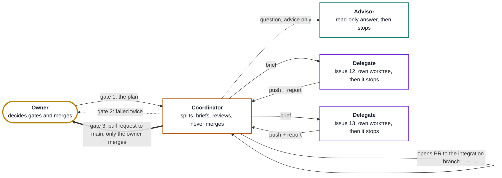

# Bive 0.0

A repository template for building software with LLM agents in three roles, on OpenCode 2:



Bive is a template and two small plugins, nothing else: a **guard** that refuses any write outside the session's
worktree, and a **counter** of human and agent tokens. No delegation tools (OpenCode 2's subagents do that), no
provider probe (a fallback rule on error), no package to install. The flow ran by hand on
the owner's first project before Bive wrote it down; Bive now develops itself with it.

## Install

New project: **Use this template** on GitHub, open OpenCode in the clone, and start the coordinator with
`.bive/prompts/COORDINATOR.md`: its first step replaces this README, `HANDOFF.md` and `ROADMAP.md` with the skeletons
of `.bive/templates/`.

Existing project: paste this into OpenCode at the root of your repository:

```text
Install https://github.com/jcherfils/bive here, in two turns. Turn 1, read only: write nothing. List what you would
add (.bive/, .opencode/plugins/, .github/, docs/, the .gitignore line; opencode.jsonc, AGENTS.md, HANDOFF.md and
ROADMAP.md when missing, the last two from .bive/templates/) and show the diff of every file that exists here and would change (AGENTS.md and
opencode.jsonc merged, this project's rules and private paths kept). Then ask me, in one message: this project's
private paths, each role's models (.bive/models.json), and whether to join Bive's public registry (docs/REGISTRY.md,
off unless I turn it on). Stop there and wait for my answer. Turn 2, only after I say yes: write, commit on a branch
install/bive, and push it. The coordinator opens a pull request against the default branch if this repository has a
remote; never create a repository or a remote.
```

Already installed, and you want Bive's newer rules? Do not copy files over: follow `docs/UPDATE.md` (two turns, one
coordinator pull request, and it never copies Bive's `.bive/registry-id`).

For projects using Bive, configure the project's own CI checks to run on pull requests and pushes to both the default
and integration branches. This makes a red base visible promptly; adapt the workflow to the project's test command.
Projects on a self-hosted runner follow `docs/SELF-HOSTED.md`.

Not a developer? `docs/FOR-HUMANS.md` explains your owner-only decisions, merge authorization and optional registry.
An advisor has no supervisory powers. Qualifications do not authorize work, teams, gates, merges or test releases.

## The flow

1. You agree the plan in `ROADMAP.md` and the split of an epic into issues (gate 1).
2. The coordinator writes one brief per issue (`.bive/templates/brief.md`), creates a worktree `issue/<n>-<slug>`
   and starts a delegate in it.
3. The delegate works only in its worktree, runs the fast checks, pushes its branch, returns its report, and stops.
4. Only the coordinator creates the pull request, using the delegate's report as its body; the coordinator reviews
   (never merges) into the integration branch. It asks you when a delegate fails twice (gate 2)
   and before the pull request to `main` (gate 3). You normally merge. The generic design also supports an explicit,
   scoped owner opt-in for a coordinator to merge named sub-coordinator PRs, never its own. This path is off by default
   and requires a fresh owner permission per invocation. See [`docs/COORDINATOR-MERGES.md`](docs/COORDINATOR-MERGES.md).

## Files

| File | What it is |
| --- | --- |
| `AGENTS.md` | The rules every agent reads first |
| `HANDOFF.md`, `ROADMAP.md` | State and plan, kept true by the coordinator (here: Bive's own) |
| `.bive/prompts/` | The three role prompts, inviolable; `project/` holds a project's additions |
| `.bive/templates/` | `brief.md` in, `report.md` out, `field-report.md` back to Bive; README/HANDOFF/ROADMAP skeletons; `supervisor-test.md` retained as a retired historical protocol, not authority |
| `docs/COORDINATING.md` | The coordinator's routine (start, review, merge, clean) as shell commands |
| `.bive/models.json` | The model order per role, for the fallback rule ([docs/PROVIDERS.md](docs/PROVIDERS.md)) |
| `opencode.jsonc` | Agents and permissions, written by hand and tight |
| `.opencode/plugins/worktree-guard/` | Refuses writes outside the worktree, shell paths included; `check.ts` decides, `index.ts` plugs it into OpenCode 2 (`node --test tests/*.test.ts`) |
| `.opencode/plugins/token-ratio/` | Counts human and agent tokens ([docs/TOKENS.md](docs/TOKENS.md)); reports to the registry if asked ([docs/REGISTRY.md](docs/REGISTRY.md)); `lib.ts` holds the pure helpers the tests import |
| `.bive/mcp-ssh.sh` | Runs a stdio MCP server on another machine over SSH ([docs/SSH.md](docs/SSH.md)) |
| `.github/` | Issue and pull request templates; `bive-inviolable` check on delegates' pull requests |

## Developing Bive

Agents work on the branch **`bived`** by pull request; `main` is the template people copy and only the owner merges
into it. Start the coordinator with the prompt in `HANDOFF.md › Running it`. MIT licence.
