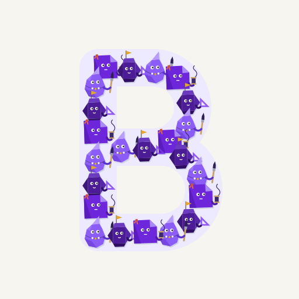

# Bive's docs

These pages are grouped by who reads them first.

## Owner

 The owner alone authorizes work and merges, approves teams and the three gates, and releases tests.

- [FOR-HUMANS.md](FOR-HUMANS.md): Your three jobs as the human owner, and what you never have to do.

## Advisor

 The advisor answers a question about the current worktree read-only, then stops; advice is never authorization.

- [ADVISOR-INVITATIONS.md](ADVISOR-INVITATIONS.md): A design for inviting another model as a read-only advisor, without granting it authority.

## Coordinator

 The coordinator splits the work into briefs, starts delegates, reviews their pull requests and asks the owner to merge.

- [ACTORS.md](ACTORS.md): How GitHub shows each agent's actions, and how the Git author and signature prove the role.
- [COORDINATING.md](COORDINATING.md): The coordinator's routine at the shell: start a delegate, review, merge, clean.
- [COORDINATOR-MERGES.md](COORDINATOR-MERGES.md): The narrow opt-in path for a coordinator to execute one named sub-coordinator merge.
- [GENERATED-DOCS.md](GENERATED-DOCS.md): How a project declares its generator so generated reference pages stay in sync on PRs.
- [PROVIDERS.md](PROVIDERS.md): How a role falls back to the next model in line when a provider call fails.
- [REGISTRY.md](REGISTRY.md): The public, anonymous, opt-in registry of projects built with Bive.
- [REQUIRED-CHECKS.md](REQUIRED-CHECKS.md): The checks a pull request needs before it merges, and where each one lives.
- [SELF-HOSTED.md](SELF-HOSTED.md): The checklist for running Bive's checks on a persistent self-hosted runner.
- [SKILL-PROVISIONING.md](SKILL-PROVISIONING.md): The accepted contract for provisioning OpenCode skills to a Bive project.
- [UPDATE.md](UPDATE.md): How a project that already uses Bive takes its newer rules, prompts, plugins and gate.

## Delegate

 The delegate works one issue in one worktree, pushes its branch, returns its report and stops.

- [ROLE-STYLE.md](ROLE-STYLE.md): Style habits for every role: fewer tokens, same rules, no greetings or filler.
- [SSH.md](SSH.md): How an agent reaches an MCP server on another machine over SSH, with no open port.

## Reference and history

- [COMPETENCIES.md](COMPETENCIES.md): A draft framework: a skill is a competency with evidence, not a role or a rank.
- [DESIGN-BRIEF.md](DESIGN-BRIEF.md): The owner-approved voice, style tokens, role glyphs and page organisation for Bive.
- [DESIGN-PLAN.md](DESIGN-PLAN.md): The plan for the organization's design, narrowed to Bive's own docs and README.
- [GITHUB-APP.md](GITHUB-APP.md): The one GitHub App that separates the agents from the owner on every action.
- [IDENTITY-BENCH.md](IDENTITY-BENCH.md): A draft protocol for testing whether a model keeps the identity it claims in its commits.
- [OWNER-ADVISOR-REWORK.md](OWNER-ADVISOR-REWORK.md): The cross-app plan for owner authority and read-only advisors, starting with Bive.
- [ROLE-CONTEXT.md](ROLE-CONTEXT.md): Measured: what each role loads and reads at session start, in bytes and tokens.
- [ROLE-START.md](ROLE-START.md): A design for settling a session's role at start, and for quick fixed-choice answers.
- [SERVER-ACCESS.md](SERVER-ACCESS.md): Research on connecting an external chat harness straight to the OpenCode server.
- [SESSION-TREE-SPIKE.md](SESSION-TREE-SPIKE.md): A spike: does a child session keep its parent when moved into an issue worktree?
- [TOKENS.md](TOKENS.md): The plugin that counts human and agent tokens, and where it writes its numbers.
- [TRIAGE-110.md](TRIAGE-110.md): The status of each of field report #110's seven remarks against the bived branch.
- [design/](design/README.md): The hand-written SVG role glyphs, flow and page icons, and their rules.
