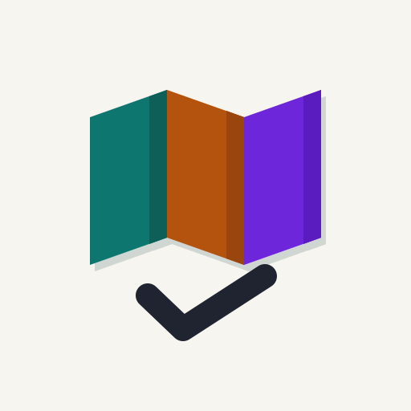
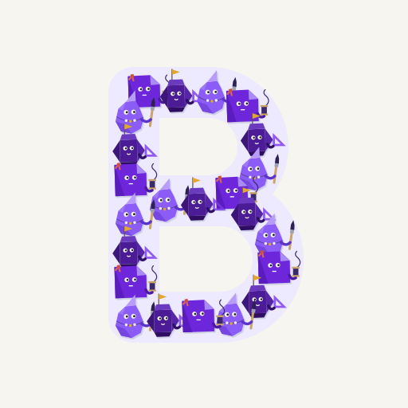
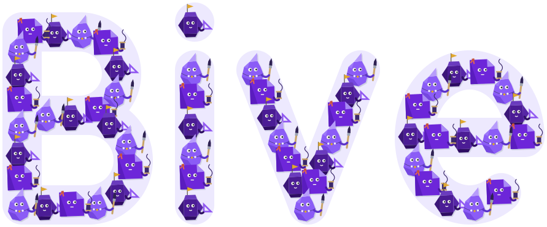

# Icon candidates (issues #328, #360)

**Chosen (owner, 2026-11-15): `icon-d`, Bive's mark.** The others stay as the record of the choice.

Four candidate icons drawn from [the Folds cast](../cast/README.md), in its cut-paper style and its colours. They are
**candidates until the owner chooses one**: nothing uses them yet.
| Candidate | Files | The idea | At 16 px |
| --- | --- | --- | --- |
|  | `icon-a.svg`, `icon-a.png` | the decision itself: agents write the card, the owner's pen decides | a light card on a dark square with a dark tick; the pen is a grey and gold fleck; the only dark ground of the candidates |
|  | `icon-b.svg`, `icon-b.png` | one companion as the face of the project: Brae, the coordinator, hands out one card and holds no pen | an amber block with a violet patch beside it; the eyes are two pale pixels, the smile is lost |
|  | `icon-c.svg`, `icon-c.png` | the team as one mark: three folds in the advisor, coordinator and delegate colours, with the owner's ink mark under them | three colour bars over a dark tick; the clearest of the candidates at this size |
|  | `icon-d.svg`, `icon-d.png` | the name's first letter made by the team: 23 small delegates (Pim, Odet, Fenn in turn, from [the companion icons](../companions/README.md)) stand along the stem and the two bowls of a B, over a pale violet shape of the letter | a soft violet B on cream, both counters open; the delegates are darker and lighter violet specks, their faces and tools appear from 64 px; the only letter of the four |

## The wordmark (issue #364)

Not a candidate: the whole name drawn the way `icon-d` draws its B, in the arrangement the owner chose (2026-11-15).

| Wordmark | File | The idea | Small |
| --- | --- | --- | --- |
|  | `wordmark.svg` | the word **Bive** (capital B, lowercase i, v, e) traced by 59 small [companions](../companions/README.md). The B is `icon-d`'s, its 23 delegates each at their place, so it matches the app icon. The i, the v and the e are each traced by every working role: delegates (Pim, Odet, Fenn in turn, 23 more), with Sill, the advisor, 6 times and Brae, the coordinator, 6 times among them. Maren, the owner, appears once and nowhere else: the dot of the i | at 200 px wide the pale letters still read "Bive"; a violet B, then teal and amber specks among the violet ones, Maren a dark dot |

It has a tight `viewBox` (891 x 370) and **no background**, so it sits on any light page; the
[social card](../social/README.md) carries a copy of it. Maren keeps her round crop, Brae is whole and smaller, and
Sill shows its flap, its top panel and the start of the next fold (the companion icons crop all three in a circle).
Written the same way as `icon-d` (see Provenance), no PNG
kept: render one with `rsvg-convert -w 600 wordmark.svg -o wordmark.png` when needed.

## The candidates' frame

Each is 512 x 512 with a full-bleed ground, and keeps what matters inside the centred circle of radius 200, so a square
or a round crop both work. The PNG files are the 512 px renders of the SVG files
(`rsvg-convert -w 512 icon-a.svg -o icon-a.png`).

## Where the chosen one goes

The organization's picture, the GitHub App's logo and the repository's social preview. All three are the owner's
uploads in GitHub's settings: no agent can set them. Once the owner has chosen, the other candidates can be deleted.

## Provenance

- Written as SVG code by `claude-fable-5-2` (through OpenCode's `claude-agent` route), in a session started by the
  coordinator, from the shapes and colours of `../cast/cast-sheet.svg` (2026-11-15). No image generator, no source
  image, no stock asset.
- `icon-d` (issue #360): written the same way by `claude-fable-5-2` (2026-11-15), reusing the paths of
  `../companions/pim.svg`, `odet.svg` and `fenn.svg` without their round grounds; the places along the letter were
  computed by a throwaway script, the file is plain SVG. A letter made of small figures is a common motif too.
- `wordmark.svg` (issue #364): written the same way by `claude-fable-5-2` (2026-11-15), from `icon-d.svg`; the i, v
  and e are plain strokes (a line, two lines, a bar and an elliptical arc), not taken from any typeface.
  Maren, Sill and Brae reuse the paths of `../companions/maren.svg`, `sill.svg` and `brae.svg`.
- **Not verified**: originality rests on judgement (no search for similar existing icons or marks was run; a card with
  a pen, a tick and a folded strip are common motifs), and the usage rights of model-written SVG are the owner's to
  confirm. The style (flat shapes, dot eyes) is a common idiom.

## Rules each file follows

`role="img"` with a `<title>` and a `<desc>`; no text inside the picture; no script, event handler, embedded image or
external link (only internal `#` references); colours from the cast sheet only; `viewBox="0 0 512 512"` (the wordmark:
its own tight `viewBox`, and no background). Checked by `tests/design-icon.test.ts`.
