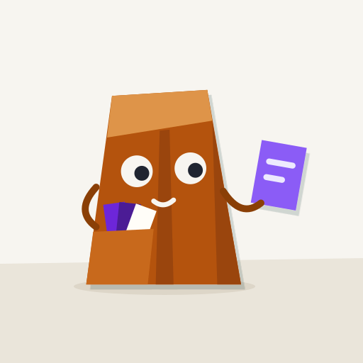

# Icon candidates (issue #328)

Three candidate icons drawn from [the Folds cast](../cast/README.md), in its cut-paper style and its colours. They are
**candidates until the owner chooses one**: nothing uses them yet.

| Candidate | Files | The idea | At 16 px |
| --- | --- | --- | --- |
|  | `icon-a.svg`, `icon-a.png` | the decision itself: agents write the card, the owner's pen decides | a light card on a dark square with a dark tick; the pen is a grey and gold fleck; the only dark ground of the three |
|  | `icon-b.svg`, `icon-b.png` | one companion as the face of the project: Brae, the coordinator, hands out one card and holds no pen | an amber block with a violet patch beside it; the eyes are two pale pixels, the smile is lost |
|  | `icon-c.svg`, `icon-c.png` | the team as one mark: three folds in the advisor, coordinator and delegate colours, with the owner's ink mark under them | three colour bars over a dark tick; the clearest of the three at this size |

Each is 512 x 512 with a full-bleed ground, and keeps what matters inside the centred circle of radius 200, so a square
or a round crop both work. The PNG files are the 512 px renders of the SVG files
(`rsvg-convert -w 512 icon-a.svg -o icon-a.png`).

## Where the chosen one goes

The organization's picture, the GitHub App's logo and the repository's social preview. All three are the owner's
uploads in GitHub's settings: no agent can set them. Once the owner has chosen, the two other candidates can be deleted.

## Provenance

- Written as SVG code by `claude-fable-5-2` (through OpenCode's `claude-agent` route), in a session started by the
  coordinator, from the shapes and colours of `../cast/cast-sheet.svg` (2026-11-15). No image generator, no source
  image, no stock asset.
- **Not verified**: originality rests on judgement (no search for similar existing icons or marks was run; a card with
  a pen, a tick and a folded strip are common motifs), and the usage rights of model-written SVG are the owner's to
  confirm. The style (flat shapes, dot eyes) is a common idiom.

## Rules each file follows

`role="img"` with a `<title>` and a `<desc>`; no text inside the picture; no script, event handler, embedded image or
external link (only internal `#` references); colours from the cast sheet only; `viewBox="0 0 512 512"`. Checked by
`tests/design-icon.test.ts`.
