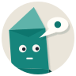
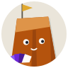
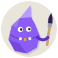
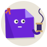
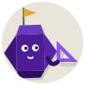

# Role column: choosing board (issue #347)

Candidates for the first column of the role table; the owner chooses one option.

## A — the 24 px role glyph alone (today)

| | Role | What it does |
| --- | --- | --- |
|  | **owner** | — |
|  | **advisor** | — |
|  | **coordinator** | — |
|  | **delegate** | — |

## B — the glyph and the companion side by side, both 24 px

| | Role | What it does |
| --- | --- | --- |
|   | **owner** | — |
|   | **advisor** | — |
|   | **coordinator** | — |
|   | **delegate** | — |

## C — the companion alone, 32 px

| | Role | What it does |
| --- | --- | --- |
|  | **owner** | — |
|  | **advisor** | — |
|  | **coordinator** | — |
|  | **delegate** | — |

## D — the glyph and the companion, both 40 px

| | Role | What it does |
| --- | --- | --- |
|   | **owner** | — |
|   | **advisor** | — |
|   | **coordinator** | — |
|   | **delegate** | — |

## E — like B, but the delegate row shows its three companions (Pim, Odet, Fenn)

| | Role | What it does |
| --- | --- | --- |
|   | **owner** | — |
|   | **advisor** | — |
|   | **coordinator** | — |
|     | **delegate** | — |
